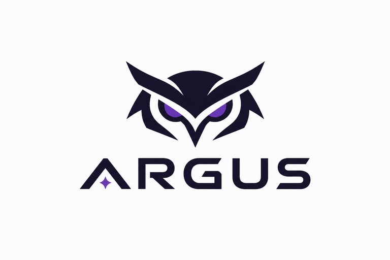

<p align="center"></p>

# Argus Agent

Trợ lý AI cá nhân chạy trên máy bạn: gateway chạy nền, giao diện web, **CLI `argus`**, skill dạng `SKILL.md`, bộ nhớ bằng markdown, tool, MCP, Telegram và automations.

## Tính năng

- **Model**: Ollama và server local (LM Studio, vLLM), Gemini, Claude, OpenAI, OpenRouter, DeepSeek (DeepSeek-R1, V3), Mistral, xAI, Groq, Cerebras, Together, Fireworks, Qwen và mọi API tương thích OpenAI. Có fallback, tự thử lại khi lỗi 429/503, ước tính chi phí. Trình duyệt và chọn mô hình local trực quan.
- **Chat**: panel Workspace bên phải (Files, Terminal, Hoạt động), mọi lần gọi tool/MCP hiện ngay trong chat, hiển thị khối "suy nghĩ chuyên sâu" (Deep Thinking / `<think>`) tự động thu gọn/mở rộng, xem trước trực tiếp (Live Preview) cho file HTML/SVG do Agent tạo, đính kèm file/ảnh, nhập bằng giọng nói, sửa và tạo lại tin nhắn, lệnh `/skill`, `@dịch vụ`. Mỗi phiên có thư mục làm việc riêng (`user-data/workspace/sessions/<id>/`).
- **Kho tài liệu & RAG (Knowledge Base)**: nạp và lập chỉ mục đa định dạng (PDF, Word `.docx`, Excel `.xlsx`, `.csv`, PowerPoint `.pptx`, Markdown, Text) với thanh tiến trình nạp trực quan. Bật chế độ "Hỏi từ tài liệu" ngay trên thanh chat để Agent đối chiếu tri thức và trả lời kèm trích dẫn nguồn gốc tương tác `[1]`, `[2]` (bấm vào xem ngay câu trích và số trang gốc).
- **Thanh công cụ tinh gọn & Tùy biến sâu**:
  - Chọn model AI trực tiếp với nhãn chi tiết.
  - Nút **Mức suy luận & Tham số**: chọn mức suy nghĩ (`Tự động`, `Suy nghĩ chuyên sâu`, `Thấp`, `Vừa`, `Cao`), thanh trượt **Nhiệt độ (Temperature)** (0.0 - 1.5) và **Độ dài tối đa (Max Tokens)** (1k - 8k).
  - Nút **Quyền hạn & Hạn mức**: chọn quyền thực thi (`Mặc định`, `An toàn`, `Toàn quyền`) và xem biểu đồ hạn mức token (Quota 5h / 7 ngày).
- **Quản lý hội thoại thông minh**: tự động đặt tên hội thoại ngắn gọn (Auto-naming) sau câu trả lời đầu tiên, ghim các phiên quan trọng lên đầu danh sách (Pin), sidebar mở rộng tự xuống dòng (`line-clamp-2`) không bị cắt tiêu đề, tìm kiếm toàn văn lịch sử chat.
- **Skills**: đọc định dạng skill `SKILL.md` (tương thích [ClawHub](https://clawhub.ai)), duyệt, cài và cập nhật từ ClawHub.
- **MCP client**: nối MCP server của bạn (stdio, HTTP, SSE); tool xuất hiện dưới dạng `tênserver__têntool`.
- **Cho app khác gọi agent**: `POST /v1/run` với API token, hoặc MCP server (`agent_run`) dùng được trong Claude Code, Cursor...
- **Chủ động**: Automations (cron), Heartbeat (agent tự kiểm tra `HEARTBEAT.md` và nhắn khi cần), Hộp thư thông báo, kênh **Telegram** (nút phê duyệt ngay trong chat, nhận/gửi file).
- **Bộ nhớ**: `MEMORY.md`, tìm kiếm toàn văn mọi hội thoại cũ (`memory_search`), tự tóm tắt hội thoại dài.
- **Song ngữ Việt/Anh**: đổi ngôn ngữ ở đầu thanh bên (và CLI theo `--lang`). Thêm chuỗi mới: bọc `t('câu tiếng Việt')` rồi thêm bản Anh vào `app/frontend/src/i18n/en/`; `npm run i18n:check` bắt chuỗi sót, thiếu bản dịch hoặc dịch xung đột.
- **An toàn mặc định**: lệnh shell, file ngoài thư mục phiên và tool MCP hỏi xác nhận; tùy chọn sandbox Docker (không mạng); mật khẩu đăng nhập tùy chọn; nhật ký mọi lần gọi tool; chỉ nhận kết nối từ localhost; token API chỉ lưu bản băm.

## Tài liệu

- [Hướng dẫn sử dụng](docs/huong-dan-su-dung.md): dành cho mọi người dùng
- [Tài liệu dòng lệnh `argus`](docs/cli.md)
- [Kiến trúc hệ thống](docs/kien-truc.md): dành cho lập trình viên

## Cài đặt

Cần Python 3.11+ (và Node 20+ nếu muốn tự build giao diện).

```bash
git clone https://github.com/tranvanhuy-hichan/argus-agent.git && cd argus-agent
python3 -m venv .venv && .venv/bin/pip install -e app/backend
(cd app/frontend && npm install && npm run build)     # giao diện web
.venv/bin/argus onboard                           # trình hướng dẫn: model, an toàn, Telegram, khởi động
```

Thêm `.venv/bin` vào `PATH` (hoặc `source .venv/bin/activate`) để gõ ngắn `argus ...`.

## CLI `argus`

| Lệnh | Việc |
|---|---|
| `argus onboard` | Cài đặt lần đầu: menu chọn bằng **↑/↓, Space (tick), Enter**, nút Có/Không đổi bằng ←/→. Khi không có terminal thật (pipe, CI, Windows) tự dùng kiểu gõ số; `--non-interactive` + cờ để tự động hóa |
| `argus start` / `stop` / `restart` / `status` | Quản lý server nền (`start -f` chạy foreground, `--host 0.0.0.0` để mở cho máy khác) |
| `argus logs -f` | Xem log |
| `argus open` | Mở giao diện web |
| `argus doctor` | Chẩn đoán (`--fix` tự sửa việc an toàn, `--offline`, `--json`) |
| `argus chat` | Trò chuyện ngay trong terminal (hỏi `y/N` khi cần phê duyệt; `/help` xem lệnh) |
| `argus run "việc cần làm"` | Chạy một lần rồi thoát: `--json`, `--exec-policy deny\|allow\|allowlist`, `--allow "git status"`, `--ask`, `--permission readonly`, `-` để đọc stdin |
| `argus token create\|list\|revoke` | API token cho `/v1/run` và MCP server |
| `argus skills list\|search\|install\|remove\|update` | Skill từ ClawHub |
| `argus service install\|uninstall\|start\|stop\|status` | Chạy cùng máy (systemd trên Linux, launchd trên macOS; `install --dry-run` để xem trước) |
| `argus backup` / `restore` | Sao lưu và khôi phục cấu hình, cơ sở dữ liệu, workspace. `--encrypt` mã hóa bằng mật khẩu, `--include-key` kèm khóa chủ, `restore --force` tự sao lưu bản hiện tại trước |
| `argus secrets status\|encrypt\|decrypt\|keychain\|file\|rotate` | Quản lý việc mã hóa khóa bí mật trong `config.json` |
| `argus config path\|show` | Xem cấu hình (API key được che) |

`chat` và `run` chạy agent ngay trong tiến trình (không cần server đang chạy) và dùng chung cấu hình, skill, MCP, hội thoại với giao diện web. Đổi ngôn ngữ CLI: `--lang vi|en` hoặc `ARGUS_LANG`.

Biến môi trường: `ARGUS_HOME` (thư mục dữ liệu), `ARGUS_PORT`, `ARGUS_HOST`, `ARGUS_CONFIG`, `ARGUS_ALLOWED_HOSTS`, `ARGUS_TOKEN`/`ARGUS_URL` (MCP server). Tên cũ `AGENT_*` vẫn được nhận.

`./run.sh` vẫn dùng được như lớp bọc mỏng quanh `argus`.

## Docker, service, test

```bash
docker compose up -d --build         # mở http://127.0.0.1:8787 (dữ liệu cá nhân ở ./user-data)
argus service install                # chạy cùng máy, không cần Docker
cd app/backend && pip install -e ".[dev]" && python -m pytest -q
```

Tìm Ollama trên máy chủ từ trong container: đặt Base URL là `http://host.docker.internal:11434/v1`.

## Giấy phép

Argus Agent là phần mềm tự do theo giấy phép **GNU AGPL-3.0-or-later** (xem [LICENSE](LICENSE)). Nếu bạn sửa đổi và cung cấp nó như một dịch vụ qua mạng, bạn phải cung cấp mã nguồn bản sửa đổi cho người dùng dịch vụ đó.

Copyright (C) 2026 tranvanhuy-hichan

## Cấu trúc thư mục

Dự án tách làm hai phần để không bao giờ nhầm lẫn mã nguồn với dữ liệu của bạn:

```
argus-agent/
├── app/                  # MÃ NGUỒN CỐ ĐỊNH: có thể xóa/cài lại bất cứ lúc nào mà không mất gì của bạn
│   ├── backend/argus/
│   │   ├── api/          # router FastAPI: chat, skills, providers, tích hợp, API ngoài (/v1)
│   │   ├── services/     # agent loop, providers, tools, skills, MCP, Telegram, scheduler, trình duyệt…
│   │   ├── core/         # cấu hình, SQLite, đường dẫn
│   │   └── cli/          # lệnh `argus` (start, doctor, onboard, chat, run, tasks, memory…)
│   ├── frontend/src/     # React + TypeScript + Tailwind (features/ theo từng trang, i18n/)
│   ├── templates/workspace/   # SOUL.md và skill mẫu, dùng để tạo workspace lần đầu
│   ├── deploy/           # file systemd mẫu
│   └── examples/         # MCP server mẫu để thử tích hợp
├── user-data/            # DỮ LIỆU CÁ NHÂN CỦA BẠN: đừng xóa, hãy sao lưu (`argus backup`)
│   ├── config.json       # cấu hình (API key đã mã hóa)
│   ├── data/             # cơ sở dữ liệu, khóa chủ (master.key), log
│   ├── workspace/        # SOUL.md, USER.md, MEMORY.md, skills/, sessions/ (tính cách, bộ nhớ, file của agent)
│   └── backups/          # các bản sao lưu
├── Dockerfile, docker-compose.yml, run.sh, .github/, LICENSE, README.md
```

Muốn để dữ liệu ở nơi khác (ổ khác, thư mục được đồng bộ…): đặt biến môi trường `ARGUS_HOME=/duong/dan`. Nếu bạn cài từ phiên bản cũ (dữ liệu nằm ngay ở thư mục gốc), Argus vẫn dùng chỗ đó cho tới khi bạn chuyển `config.json`, `data/`, `workspace/`, `backups/` vào `user-data/`.

## Lưu ý bảo mật

- Skill tải từ internet chỉ là hướng dẫn, nhưng có thể bảo agent chạy lệnh. Đọc `SKILL.md` trước khi cài và giữ xác nhận lệnh shell luôn bật.
- MCP server stdio chạy lệnh bạn khai báo với quyền của chính bạn. Chỉ thêm server bạn tin tưởng.
- `user-data/config.json` (cả thư mục `user-data/` đã nằm trong `.gitignore`). Mọi khóa bí mật trong đó (API key, token Telegram, biến môi trường/header MCP, khóa skill) được **mã hóa** bằng khóa chủ lấy từ `ARGUS_MASTER_KEY`, keychain hệ điều hành (`pip install keyring` rồi `argus secrets keychain`) hoặc `user-data/data/master.key` (quyền 600). Việc này bảo vệ khi file config bị lộ riêng lẻ (gửi kèm báo lỗi, đẩy nhầm lên git, sao lưu rời khóa chủ); **không** bảo vệ khi kẻ tấn công có cả hai file hoặc đang chạy trên máy của bạn. Hãy sao lưu khóa chủ (`argus backup --include-key --encrypt`): mất nó thì không giải mã lại được. `argus doctor` kiểm tra tình trạng này.
