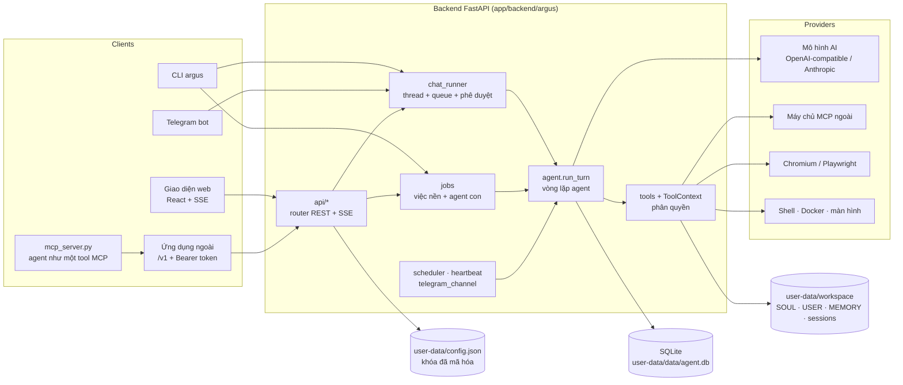
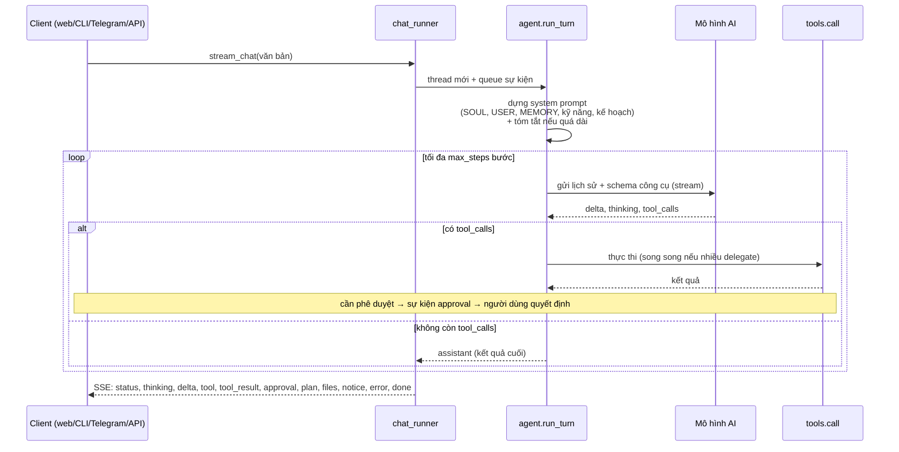

# Kiến trúc hệ thống Argus Agent

Tài liệu này dành cho người muốn hiểu cách Argus hoạt động bên trong hoặc muốn sửa và mở rộng nó. Người dùng cuối nên đọc [Hướng dẫn sử dụng](huong-dan-su-dung.md); danh sách lệnh nằm ở [cli.md](cli.md).

## Mục lục

1. [Tổng quan](#1-tổng-quan)
2. [Cấu trúc thư mục](#2-cấu-trúc-thư-mục)
3. [Backend](#3-backend)
4. [Vòng lặp agent](#4-vòng-lặp-agent)
5. [Công cụ (tools) và phân quyền](#5-công-cụ-tools-và-phân-quyền)
6. [Các hệ thống con](#6-các-hệ-thống-con)
7. [Dữ liệu và lưu trữ](#7-dữ-liệu-và-lưu-trữ)
8. [API bên ngoài](#8-api-bên-ngoài)
9. [REST API nội bộ cho giao diện](#9-rest-api-nội-bộ-cho-giao-diện)
10. [Frontend](#10-frontend)
11. [Bảo mật](#11-bảo-mật)
12. [Mở rộng hệ thống](#12-mở-rộng-hệ-thống)
13. [Kiểm thử và CI](#13-kiểm-thử-và-ci)
14. [Triển khai](#14-triển-khai)

---

## 1. Tổng quan

Argus Agent là một ứng dụng web chạy cục bộ gồm một **backend Python (FastAPI)**, một **giao diện React**, và một **CLI `argus`**. Cả ba dùng chung một lõi dịch vụ (services), nên làm gì trên giao diện cũng làm được bằng dòng lệnh hoặc API.



Nguyên tắc thiết kế chính:

- **Một lõi, nhiều cửa vào.** Web, CLI, Telegram, API ngoài, tự động hóa và việc nền đều gọi cùng `agent.run_turn`. Chúng khác nhau ở *nguồn* (`source`), *người duyệt* (approver) và *chế độ quyền*.
- **Cục bộ trước.** Mặc định server chỉ nghe `127.0.0.1`. Không cần cổng ra internet (Telegram dùng long polling).
- **An toàn theo mặc định.** Công cụ nguy hiểm đều đi qua một cổng phê duyệt; khi không có người duyệt thì từ chối.
- **Mở rộng bằng cách thả file.** Thêm công cụ, router API hoặc lệnh CLI chỉ cần thêm một file theo quy ước, không sửa các file lõi (xem [mục 12](#12-mở-rộng-hệ-thống)).
- **Tách mã và dữ liệu.** Mã cố định nằm trong `app/`, dữ liệu cá nhân nằm trong `user-data/`.

### Kho tài liệu (`services/knowledge.py`, `tools_kb.py`, `api/knowledge.py`)

Hỏi đáp trên tài liệu của người dùng. `add_file` lưu bản sao vào `workspace/knowledge/<id>/`, chống trùng bằng sha256 rồi đọc và lập chỉ mục ở luồng nền (`_index`). Bộ đọc theo định dạng trả về `(vị trí, văn bản)`: PDF theo trang (`pypdf`, báo "cần OCR" nếu quá nửa số trang không có chữ), Word theo mục tiêu đề hoặc cụm đoạn (đọc XML bằng `zipfile`), Excel theo sheet và cụm 25 dòng có kèm dòng tiêu đề, PowerPoint theo slide, còn lại theo cụm 40 dòng. Có chặn file nén quá lớn. Văn bản chia bằng `memory_index.chunk_text` (≈900 ký tự).

Bảng `kb_docs`, `kb_chunks`, `kb_fts` (FTS5 trên chữ đã bỏ dấu) và `kb_vecs` (vector theo `model_id`), tách riêng khỏi `memory_vectors` nên `memory reindex` không xóa tài liệu. `search()` gộp từ khóa và vector bằng reciprocal-rank fusion; lỗi embedding thì vẫn tìm được bằng từ khóa. Tool `kb_search` trả các đoạn kèm `Nguồn: tên file, vị trí`; tool bị ẩn khi kho trống (tiết kiệm token) và `knowledge_note()` nhắc agent dùng nó và luôn trích nguồn.

**Giao diện ngoài cho kho tài liệu.** `api/external.py` có `/v1/documents` (liệt kê, thêm, xóa, `search`, `ask`); thêm và xóa cần cột `api_tokens.allow_docs` (mặc định 0), đọc và hỏi đáp thì mọi token đều dùng được. `ask` chạy `api_run.run_once(..., docs=True)` rồi `knowledge.plain_sources` đổi thẻ `[[src:...]]` thành chữ thường và trả danh sách nguồn. `mcp_server.py` bọc các endpoint đó thành công cụ `kb_*`. Chế độ "Hỏi từ tài liệu" là cờ `docs` của `/api/chat` (và `use_docs` của `agent.run_turn`): giới hạn công cụ còn `kb_search`, tìm sẵn các đoạn liên quan đưa vào lời nhắc để thường chỉ cần một lượt gọi model. Phân tích tài liệu là job `kind="analysis"` trong `jobs.execute`: dùng `knowledge.overview` (đầu mỗi tài liệu cộng các đoạn khớp trọng tâm) và `ANALYSIS_PROMPT` để ra báo cáo có cấu trúc.

## Ứng dụng desktop (`app/desktop/`)

Dành cho người dùng không chuyên. Gồm hai lớp:

1. **Server đóng gói** (`argus-server.spec`, PyInstaller): toàn bộ backend, giao diện web đã build (`frontend/dist`) và mẫu workspace trong một thư mục tự chứa. Điểm vào là `argus/desktop_server.py` (`server_entry.py`): chọn cổng (ưu tiên 18787 cố định để đăng nhập OAuth của MCP còn hiệu lực, bận thì lấy cổng trống), in `ARGUS_READY <cổng>` khi sẵn sàng. `core/paths.py` nhận biết bản đóng băng (`sys.frozen`, `sys._MEIPASS`) để tìm `frontend/dist` và `templates`. Chạy ở chế độ UTF-8 vì Windows mặc định cp1252.
2. **Vỏ Electron** (`main.js`): khoá một bản chạy, chạy server với `ARGUS_HOME` là thư mục dữ liệu người dùng, đợi dòng sẵn sàng rồi mở `BrowserWindow` trỏ vào `http://127.0.0.1:<cổng>`. Liên kết ra ngoài mở bằng trình duyệt hệ thống. Thoát app thì dừng cả cây tiến trình server.

`electron-builder` tạo AppImage và deb (Linux), trình cài đặt NSIS (Windows). Workflow `.github/workflows/desktop.yml` dựng cả hai khi có tag `v*`, chạy `smoke_test.py` trên bản server đóng gói trước khi đóng app.

Tương thích Windows ở backend: lệnh `exec` dùng bash nếu có (Git Bash) và nếu không thì cmd.exe, đồng thời prompt báo cho model biết; tìm Chrome/Edge ở đường dẫn mặc định; bỏ qua các lời gọi chỉ có trên POSIX (`getuid`, `SIGKILL`).

## 2. Cấu trúc thư mục

```
argus-agent/
├── app/                          MÃ NGUỒN CỐ ĐỊNH (có thể xóa/cài lại, không mất dữ liệu)
│   ├── backend/
│   │   ├── pyproject.toml        khai báo gói, phụ thuộc, extras (dev, keyring)
│   │   ├── argus/
│   │   │   ├── main.py           tạo app FastAPI, middleware bảo vệ, nạp router, vòng đời
│   │   │   ├── mcp_server.py     MCP server (stdio) đưa agent ra ngoài như một tool
│   │   │   ├── api/              router HTTP (mỗi file một nhóm chức năng)
│   │   │   ├── services/         logic nghiệp vụ: agent, công cụ, nhà cung cấp, MCP, bộ nhớ…
│   │   │   ├── core/             cấu hình, SQLite, đường dẫn, mã hóa khóa, workspace mẫu
│   │   │   └── cli/              các lệnh argus
│   │   └── tests/                pytest
│   ├── frontend/
│   │   ├── src/                  React + TypeScript + Tailwind
│   │   ├── scripts/              check-i18n.mjs
│   │   └── dist/                 giao diện đã build (không commit)
│   ├── templates/workspace/      SOUL.md và skill mẫu để tạo workspace lần đầu
│   ├── deploy/argus.service      file systemd mẫu
│   └── examples/                 MCP server mẫu
├── user-data/                    DỮ LIỆU CÁ NHÂN (không commit, không xóa)
│   ├── config.json
│   ├── data/                     agent.db, master.key, server.log, server.pid, browser/
│   ├── workspace/                SOUL.md, USER.md, MEMORY.md, HEARTBEAT.md, skills/, sessions/
│   └── backups/
├── docs/                         tài liệu (thư mục này)
├── Dockerfile · docker-compose.yml · run.sh · .github/workflows/ci.yml
└── LICENSE · README.md
```

Đường dẫn được quyết định trong `core/paths.py`:

| Hằng số | Giá trị | Ý nghĩa |
|---|---|---|
| `CODE_ROOT` | `<repo>/app` | Mã nguồn cố định |
| `ROOT` | `ARGUS_HOME` hoặc `<repo>/user-data` | Dữ liệu cá nhân |
| `DATA` | `ROOT/data` | Cơ sở dữ liệu, khóa, log |
| `CONFIG_PATH` | `ARGUS_CONFIG` hoặc `ROOT/config.json` | Cấu hình |
| `DIST` | `CODE_ROOT/frontend/dist` | Giao diện đã build |

Tương thích bố cục cũ: nếu `user-data/` chưa có nhưng `config.json` hoặc `data/agent.db` còn nằm ở thư mục gốc repo, `ROOT` là thư mục gốc đó để không mất dữ liệu.

## 3. Backend

### 3.1 Các lớp

```
api/        HTTP: nhận request, kiểm tra đầu vào, gọi services, trả JSON hoặc SSE
services/   nghiệp vụ, không biết gì về HTTP
core/       nền tảng dùng chung: cấu hình, DB, đường dẫn, mã hóa
cli/        giao diện dòng lệnh, gọi thẳng services (không qua HTTP)
```

Quy tắc phụ thuộc: `api` và `cli` → `services` → `core`. `services` không import `api` hay `cli`.

### 3.2 `main.py`

- Tạo `FastAPI(title="Argus Agent")` với `lifespan` khởi động: `db.init()`, `ensure_workspace()`, `jobs.recover_interrupted()` (đánh dấu việc nền bị gián đoạn), `scheduler.start()`, kết nối MCP, `telegram.apply()`, `heartbeat.start()`; dừng chúng khi tắt.
- **Middleware `guard`** (xem [mục 11](#11-bảo-mật)): chặn host lạ, yêu cầu đăng nhập nếu có mật khẩu, chặn origin lạ với request ghi.
- Nạp router: một danh sách cố định (`system, chat, skills, dashboard, integrations, files, activity, channels`) dưới tiền tố `/api`, router `external` dưới `/v1`, và **tự nạp** mọi `api/*.py` có `AUTO = True` (hiện là `tasks`, `memory`).
- Phục vụ giao diện build sẵn từ `DIST`; mọi đường dẫn khác trả `index.html` (SPA).

### 3.3 `services/` (các module chính)

| Nhóm | Module | Vai trò |
|---|---|---|
| Lõi agent | `agent.py` | Vòng lặp agent, dựng system prompt, thực thi công cụ, chuyển nhà cung cấp dự phòng |
| | `chat_runner.py` | Chạy một lượt chat ở thread riêng, đẩy sự kiện vào queue cho SSE, quản lý phê duyệt, tự động đặt tên hội thoại thông minh (`_auto_title`) |
| | `tools.py` | Đăng ký công cụ (`@tool`), `ToolContext`, công cụ cốt lõi (file, exec, web, http…) |
| | `providers.py` | Bộ chuyển đổi mô hình: OpenAI-compatible, Anthropic, CLI; streaming, bóc tách khối suy nghĩ `<think>`, nhận tham số `temperature` và `max_tokens` |
| | `compaction.py` | Tóm tắt phần đầu hội thoại khi quá dài |
| | `sessions.py` | Hội thoại và tin nhắn (CRUD, tìm kiếm FTS, ghim phiên `pinned`) |
| | `workfiles.py` | Thư mục làm việc từng phiên, kiểm tra đường dẫn an toàn |
| Công cụ mở rộng | `tools_plan.py`, `plans.py` | Kế hoạch từng phiên (`plan_set/update/show`) |
| | `tools_agents.py`, `jobs.py` | Agent con (`delegate`) và việc nền (`task_*`) |
| | `tools_browser.py`, `browser.py` | Điều khiển trình duyệt bằng Playwright |
| | `tools_media.py` | Tạo ảnh, xem ảnh |
| | `tools_memory.py` | `memory_search` kết hợp từ khóa và ngữ nghĩa |
| | `tools_computer.py` | Điều khiển màn hình, chuột, bàn phím |
| Trí nhớ | `embeddings.py`, `vectorstore.py`, `memory_index.py`, `memory.py` | Nhúng, lưu vector, lập chỉ mục nền, dọn `MEMORY.md` |
| Tích hợp | `mcp_client.py` | Kết nối máy chủ MCP ngoài và đưa công cụ của chúng cho agent |
| | `skills.py`, `clawhub.py`, `hub_install.py` | Kỹ năng và kho ClawHub |
| | `telegram_channel.py` | Bot Telegram (long polling, ghép đôi, phê duyệt qua nút bấm) |
| | `tokens.py`, `api_run.py` | API token và chạy một yêu cầu cho API ngoài/CLI |
| Nền | `scheduler.py` | Việc theo lịch cron |
| | `heartbeat.py` | Tự kiểm tra định kỳ |
| | `notifications.py` | Hộp thư và đẩy sang Telegram |
| Quan sát | `audit.py`, `usage.py` | Nhật ký công cụ, thống kê token và chi phí |
| Hệ thống | `auth.py`, `backup.py` | Mật khẩu giao diện, sao lưu/khôi phục |

### 3.4 `core/`

| Module | Vai trò |
|---|---|
| `config.py` | Các model pydantic của cấu hình (`Config`, `ProviderCfg`, `AgentCfg`, `BrowserCfg`, `MemoryCfg`, `MediaCfg`, `ComputerCfg`, `AgentsCfg`…), `load()`, `save()`, `masked()` |
| `db.py` | Kết nối SQLite, schema, migration nhẹ, bật FTS5 nếu có |
| `paths.py` | Đường dẫn như trên |
| `secrets.py` | Mã hóa Fernet cho khóa bí mật, quản lý khóa chủ (env, keychain, file) |
| `workspace.py` | Tạo workspace lần đầu từ mẫu |
| `presets.py` | Mẫu dịch vụ cho `onboard` |
| `text.py` | `fold()`: chuẩn hóa chữ (bỏ dấu, `đ`→`d`) để tìm kiếm tiếng Việt |
| `env.py` | `getenv("X")` đọc `ARGUS_X` (nhận cả `AGENT_X` cũ) |

## 4. Vòng lặp agent

Hàm trung tâm: `agent.run_turn(sid, text, provider, approver, emit, cancel, only_tools, source, attachments, permission, effort, system_extra, max_steps, depth, job_id, workdir_sid)`.



Các bước cụ thể:

1. **Chuẩn bị.** Tải kỹ năng, tạo thư mục làm việc `workspace/sessions/<sid>/` (hoặc của phiên cha nếu là agent con/việc nền, qua `workdir_sid`), dựng `ToolContext` với quyền tương ứng (`apply_permission`).
2. **System prompt** (`build_system_prompt`): thông tin ngày giờ, thư mục làm việc, nội dung `SOUL.md`, `USER.md`, `MEMORY.md` (mỗi file lấy tối đa 4000 ký tự cuối), danh sách kỹ năng đang hoạt động, hướng dẫn dùng kế hoạch, kế hoạch hiện tại của phiên.
3. **Nén hội thoại.** Nếu lịch sử dài hơn `agent.compact_chars`, phần cũ được tóm tắt bằng chính mô hình, chỉ giữ vài lượt gần nhất nguyên văn.
4. **Gọi mô hình** có streaming. Lỗi tạm thời (429, 503, hết giờ) được **thử lại** tối đa 4 lần với độ trễ tăng dần; nếu vẫn lỗi thì chuyển sang **nhà cung cấp dự phòng** theo thứ tự trong `fallback`.
5. **Thực thi công cụ.** Mỗi `tool_call` đi qua `tools.call`, có ghi **nhật ký** (`audit`) và gửi sự kiện `tool`/`tool_result`. Nhiều lời gọi `delegate` trong cùng một lượt chạy **song song**.
6. **Kết thúc** khi mô hình trả lời không gọi công cụ nữa, hết `max_steps`, bị hủy (`cancel`), hoặc lỗi không phục hồi được. Mỗi lần gọi mô hình ghi vào bảng `usage`.

### Sự kiện SSE

| Sự kiện | Nội dung |
|---|---|
| `session` | id hội thoại (đầu luồng) |
| `status` | trạng thái ngắn ("Đang gọi …") |
| `thinking`, `delta` | luồng "suy nghĩ" và luồng văn bản trả lời |
| `assistant` | câu trả lời hoàn chỉnh, mô hình đã dùng, token, thời gian |
| `tool`, `tool_result` | bắt đầu và kết quả của một lần gọi công cụ |
| `approval` | cần người dùng cho phép (id, loại, chi tiết) |
| `plan` | kế hoạch vừa thay đổi |
| `files` | có thay đổi file trong thư mục làm việc |
| `notice`, `error` | thông báo và lỗi; mang `tpl` + `vars` để giao diện dịch |
| `ping`, `done` | giữ kết nối mỗi 15 giây; kết thúc lượt |

Thông điệp hướng người dùng do backend sinh ra đều là **mẫu tiếng Việt kèm biến** (`ui_event(kind, tpl, **vars)`), để giao diện tự dịch sang tiếng Anh khi cần.

### Nguồn (`source`) và người duyệt

| Nguồn | Người duyệt | Ghi chú |
|---|---|---|
| `chat` (web) | Người dùng, qua SSE `approval` và `POST /api/approvals/{id}` | Chờ tối đa 300 giây, hết giờ coi như từ chối |
| `cli` (`argus chat`) | Hỏi `y/N` trong terminal | |
| `cli` (`argus run`) | Theo `--exec-policy` | Mặc định từ chối |
| `api` (`/v1/run`) | Theo `exec_policy` và quyền của token | Mặc định từ chối |
| `telegram` | Nút Cho phép/Từ chối trong Telegram | Tin nhắn mới hoặc `/stop` tự từ chối phê duyệt đang chờ |
| `automation`, `heartbeat` | Không có → từ chối | Mọi thao tác cần phê duyệt bị từ chối |
| `task`, `subagent` | Việc nền: không có (từ chối). Agent con: dùng lại người duyệt của agent cha | |

## 5. Công cụ (tools) và phân quyền

### 5.1 Đăng ký công cụ

Công cụ là hàm Python gắn decorator trong `services/tools.py` (và các file `tools_*.py`):

```python
@tool("read", "Đọc nội dung một file text.", {"path": ("string", "đường dẫn file")}, risk="file")
def read_file(ctx, path):
    return _resolve(ctx, path, "read").read_text(errors="replace")[:20000]
```

- Tham số có kiểu `string`, `integer`, `boolean`, `array` (phần tử chuỗi); schema JSON sinh tự động cho mô hình.
- `risk` là một trong `safe`, `file`, `network`, `exec` (và `mcp` cho công cụ của máy chủ MCP). Trang Cài đặt → Công cụ dựa vào đó để gắn nhãn.
- Các module `tools_plan`, `tools_agents`, `tools_browser`, `tools_memory`, `tools_media`, `tools_computer` được nạp tùy chọn ở cuối `tools.py`. Nếu một module lỗi khi nạp thì hệ thống vẫn chạy, lỗi được ghi vào `tools.LOAD_ERRORS` và `argus doctor` báo ra.

### 5.2 `ToolContext`

Mỗi lượt chạy có một `ToolContext` mang: thư mục làm việc (`cwd`) và workspace, **người duyệt** (`approver`), cờ `confirm_exec`/`confirm_writes`/`full_access`, `session_id`, `depth` (độ sâu agent con), `permission`, nhà cung cấp, hàm `emit`, sự kiện `cancel`, tập công cụ bật, kỹ năng, công cụ MCP bổ sung và cấu hình sandbox.

### 5.3 Các công cụ hiện có

| Nhóm | Công cụ | Rủi ro |
|---|---|---|
| File | `read`, `write`, `edit`, `list_dir`, `read_document` | file |
| Lệnh | `exec` (shell, tùy chọn trong Docker) | exec |
| Web | `web_search`, `web_fetch`, `http_request` | network |
| Trí nhớ | `remember`, `memory_search`, `skills_read` | safe |
| Thông báo | `notify` | safe |
| Kế hoạch | `plan_set`, `plan_update`, `plan_show` | safe |
| Đa agent | `delegate`, `task_start`, `task_status`, `task_cancel` | safe |
| Trình duyệt | `browser_open`, `_snapshot`, `_click`, `_type`, `_press`, `_scroll`, `_back`, `_text`, `_screenshot`, `_close` | network |
| Ảnh | `generate_image` (network), `view_image` (file) | |
| Máy tính | `computer_screenshot`, `_click`, `_move`, `_type`, `_key`, `_scroll` | exec |
| MCP | mọi công cụ của máy chủ MCP, tên `server__tool` | mcp |

### 5.4 Chế độ quyền

`apply_permission` điều chỉnh `ToolContext` theo chế độ:

| Chế độ | Hiệu ứng |
|---|---|
| `default` | Theo cấu hình: `exec` cần phê duyệt nếu `confirm_exec`; đọc/ghi trong thư mục làm việc tự do; **đụng file ngoài workspace thì cần phê duyệt** |
| `readonly` | Tắt mọi công cụ `exec` và công cụ MCP không đánh dấu read-only, cùng danh sách `READONLY_BLOCKED` (`write`, `edit`, `remember`, `http_request`, `generate_image`, `browser_click/type/press`, `task_start`, toàn bộ `computer_*`) |
| `guarded` | `confirm_exec` và `confirm_writes` đều bật: hỏi cả khi ghi file, gọi MCP, gửi HTTP không phải GET, tạo ảnh |
| `full` | Không hỏi, `full_access`: file và lệnh không giới hạn (trừ sandbox Docker nếu bật) |

Phê duyệt đi qua `ctx.approve(kind, detail)`. Các `kind` gồm `exec`, `file_read`, `file_write`, `http_request`, `mcp`, `browser`, `image`, `computer`.

Chống truy cập địa chỉ nội bộ: `web_fetch`/`http_request` phân giải DNS và **từ chối IP riêng, loopback, link-local, reserved** (chống SSRF), kể cả khi bị chuyển hướng; trình duyệt chặn địa chỉ nội bộ trừ khi `browser.allow_private` bật.

## 6. Các hệ thống con

### 6.1 Nhà cung cấp mô hình (`providers.py`)

Hai bộ chuyển đổi: `OpenAICompat` (OpenAI, Gemini, Ollama, LM Studio, vLLM, Groq, DeepSeek, OpenRouter, Mistral, xAI, Together, Fireworks, Qwen, Cerebras… mọi dịch vụ có `/chat/completions`) và `Anthropic`. Cả hai stream sự kiện chuẩn hóa: `delta`, `thinking`, `tool_calls`, `usage`. Khóa API lấy từ `api_key` (đã mã hóa) hoặc biến môi trường `api_key_env`. `list_models` liệt kê model, mặc định lọc bỏ model không dùng để chat.

**Nhà cung cấp CLI** (`cli_provider.py`, `type="cli"`): dùng một CLI đã đăng nhập làm mô hình, thay cho API key. Mỗi CLI là một *adapter* gồm hàm dựng lệnh, hàm đọc từng dòng JSON và danh sách biến môi trường cần gỡ để CLI dùng tài khoản đăng nhập thay vì khóa API:

| CLI | Lệnh chạy | Cách nhận lời nhắc | Ghi chú |
|---|---|---|---|
| `claude` | `claude -p --output-format stream-json --tools "" --no-session-persistence --strict-mcp-config` | stdin | Tắt hẳn công cụ riêng bằng cờ; gỡ `ANTHROPIC_API_KEY`/`ANTHROPIC_AUTH_TOKEN` |
| `agy` (Antigravity) | `agy --output-format stream-json --disable-slash-commands [--model m] -p <lời nhắc>` | **tham số** (`-p` phải đứng cuối, vì nó lấy tham số kế tiếp làm lời nhắc) | Không có cờ tắt công cụ riêng (60+ công cụ) nên chỉ dựa vào giao thức; giới hạn 120.000 ký tự; `agy models` liệt kê model thật |
| `codex` | `codex exec --json --skip-git-repo-check --sandbox read-only -o <file> [--model m] <lời nhắc>` | tham số | **Chưa kiểm chứng với bản thật**: đọc sự kiện `item.completed` (agent_message) và `turn.completed`, dự phòng đọc file `-o`; gỡ `CODEX_API_KEY`/`OPENAI_API_KEY` |
| `custom` | lệnh tự khai báo | stdin | Đầu ra văn bản thuần |

Mỗi bước chạy một tiến trình trong thư mục trống `data/cli-run/` (để CLI không đọc dự án nào). Công cụ của Argus được mô tả trong prompt và model gọi bằng khối `<tool_call>{"name": …, "arguments": {…}}</tool_call>`. Bộ lọc luồng chỉ cho phần văn bản đứng trước khối này hiện ra, `parse_calls` tách các lời gọi, rồi vòng lặp agent chạy công cụ như mọi nhà cung cấp khác (giữ nguyên phê duyệt, kế hoạch, nhật ký). Lịch sử được gửi lại dạng bản ghi văn bản mỗi bước (không dùng phiên của CLI). `argus doctor` chỉ kiểm tra lệnh có tồn tại (không gọi mạng). Đã chạy thật với `claude` và `agy`; `codex` mới được kiểm thử bằng CLI giả theo tài liệu.

### 6.2 Kỹ năng (`skills.py`, `clawhub.py`)

Một kỹ năng là thư mục có `SKILL.md` (đầu file là YAML frontmatter: `name`, `description`, `metadata` với các điều kiện `requires.bins`, `requires.env`, `os`…). `discover()` quét `workspace/skills/`, đánh giá điều kiện (`missing`) và hợp nhất với cấu hình bật/tắt. Danh sách kỹ năng đang hoạt động được đưa vào system prompt; nội dung đầy đủ chỉ nạp khi mô hình gọi `skills_read` hoặc người dùng gõ `/<tên>`. Cài từ ClawHub kiểm tra gói (giới hạn số file và dung lượng, chống đường dẫn thoát) và lưu nguồn gốc để cập nhật.

### 6.3 MCP

- **Client** (`mcp_client.py`): kết nối máy chủ MCP theo `stdio`, `http` (Streamable HTTP) hoặc `sse`; chạy trong thread riêng với vòng lặp asyncio; liệt kê công cụ và đăng ký thành công cụ `server__tool` với `risk="mcp"`; tự kết nối lại; trạng thái hiển thị ở trang Kết nối.
- **OAuth** (`mcp_oauth.py`): MCP từ xa của Notion, Canva, Linear, Atlassian, Asana… yêu cầu OAuth 2.1. `OAuthClientProvider` của SDK lo giao thức (khám phá máy chủ cấp quyền, **đăng ký client động**, PKCE S256, đổi mã lấy token, làm mới token); Argus cung cấp ba mảnh:
  - `Store`: lưu client và token vào bảng `kv` (khóa `mcp_oauth:<tên>`) dưới dạng JSON **mã hóa Fernet** bằng khóa chủ. Client đăng ký gắn với `redirect_uri`; đổi địa chỉ/cổng Argus thì xóa client và token cũ để đăng ký lại.
  - `Flow`: `redirect_handler` ghi URL cấp quyền vào trạng thái của server (`status="needs_auth"`, `auth_url`), `callback_handler` chờ một `Future` (tối đa 300 giây) cho tới khi `GET /api/mcp/oauth/callback?code&state` gọi `complete()`. Ở chế độ không tương tác (lúc khởi động, kết nối lại) `redirect_handler` ném `NeedsAuth` nên không bao giờ chờ.
  - Quy trình: server bật `oauth` mà chưa có token thì không thử kết nối (không đăng ký client vô ích) và ở trạng thái `needs_auth`. `POST /api/mcp/{name}/oauth/start` chạy lại kết nối ở chế độ tương tác với địa chỉ gọi lại lấy từ chính request, trả `auth_url` để giao diện mở trong tab mới. Sau khi người dùng cho phép, kết nối hoàn tất, các lần khởi động sau dùng token đã lưu (SDK tự làm mới). `POST /api/mcp/{name}/oauth/logout` xóa token.
  - Kiểm chứng: test đi qua toàn bộ luồng với máy chủ MCP + máy chủ cấp quyền giả; đã chạy khám phá và đăng ký client thật với Notion, Linear, Canva, Atlassian và Asana (Figma từ chối đăng ký động nên không có mẫu). Phần người dùng bấm "Cho phép" và đổi mã trên dịch vụ thật chưa được thử.
- **Gọi bằng `@`** (`agent.mentioned_servers`, `agent.apply_mentions`): nếu tin nhắn có `@tên` khớp một MCP server trong cấu hình (không khớp địa chỉ email), `run_turn` chỉ giữ công cụ của các server được gọi cùng công cụ lõi (tắt phần còn lại trong `ctx.enabled`, sau cả `only_tools`), thêm vào system prompt lời nhắc dùng công cụ có tiền tố `tên__`, và phát sự kiện `notice` nếu server chưa kết nối. Áp dụng cho mọi nguồn (web, Telegram, API, việc nền). Giao diện: bộ chọn `@` trong `Composer` và tô màu `@tên` trong tin nhắn.
- **Danh mục, thư viện và thăm dò**:
  - `mcp_catalog.py`: **42 dịch vụ đã kiểm chứng** theo nhóm (`GET /api/mcp/catalog`). Mỗi mục được thử bằng chính luồng của SDK trên địa chỉ thật: `oauth` (lấy được địa chỉ đăng nhập), `open` (kết nối và liệt kê được công cụ không cần đăng nhập) hoặc `token` (nhà cung cấp không cho tự đăng ký, ví dụ GitHub dùng PAT trong header `Authorization`). Dịch vụ thử không được (Slack, HubSpot, Box, Calendly, Gamma, Figma) bị loại; mô tả có hai ngôn ngữ.
  - `mcp_registry.py`: tìm trong thư viện MCP chính thức (`GET /api/mcp/registry?q=&cursor=`), chỉ giữ mục có máy chủ từ xa (`streamable-http`/`sse`, không có biến trong URL), bỏ trùng, gắn nhãn `community` cho tên miền không chứng minh được thương hiệu. Nội dung do cộng đồng đăng, không kiểm duyệt.
  - `mcp_probe.py`: `POST /api/mcp/probe` gửi `initialize` không kèm xác thực rồi đọc phản hồi để phân loại `oauth` / `oauth-manual` / `token` / `open` / `down` (đi theo `WWW-Authenticate`, metadata tài nguyên và máy chủ cấp quyền, kiểm tra có `registration_endpoint`). API chặn địa chỉ nội bộ (`_check_url`). Kết quả thăm dò chỉ là gợi ý; luồng đăng nhập thật của SDK mới là phép thử cuối (Figma công bố đăng ký động nhưng trả 403).
  - Cờ `service` trong cấu hình server MCP đánh dấu server thêm từ tab dịch vụ (cả OAuth, token lẫn mở), để tab `MCP truyền thống` không hiển thị lẫn.
- **Giao diện Kết nối**: tab `MCP server` (`McpTab`, server không dùng OAuth và không có cờ `service`) và mục **Tiện ích** (plugin) riêng ở thanh bên, route `/plugins` (`PluginsPage` bọc `ServicesTab`; `/integrations?tab=services` chuyển hướng sang đó) (`ServicesTab`: ô tìm kiếm, danh mục theo nhóm với logo (`ServiceLogo`: `simple-icons`, vài SVG riêng, chữ cái đầu cho dịch vụ chưa có logo), hộp thoại token, kết quả thư viện với cảnh báo). Nút Dùng lưu cấu hình rồi gọi `POST /api/mcp/{name}/oauth/start` (kiểu OAuth).
- **Server** (`mcp_server.py`): chạy độc lập qua stdio, chỉ gọi HTTP `/v1/*` của agent đang chạy nên không phụ thuộc phần còn lại của mã. Cho phép Claude Code, Cursor… giao việc cho agent. Cần `ARGUS_TOKEN`.

### 6.4 Kế hoạch, việc nền và agent con

- **Kế hoạch** (`plans.py`, bảng `plans`): danh sách bước theo phiên, trạng thái `pending | in_progress | done | blocked`; mỗi lần đổi, công cụ phát sự kiện `plan` và kế hoạch được đưa lại vào system prompt.
- **Việc (`jobs.py`, bảng `jobs`)**: một khái niệm chung cho **việc nền** (`kind=task`) và **agent con** (`kind=subagent`).
  - `create` ghi dòng ở trạng thái `queued`; `execute` chạy `agent.run_turn` đến khi xong, cập nhật `status` (`running` → `done | failed | cancelled`), số bước, tiến độ và kết quả.
  - `start_background` chạy ở thread nền, giới hạn đồng thời bằng semaphore `agents.max_parallel`.
  - `run_subagent` chạy đồng bộ, **dùng lại người duyệt và cờ hủy của agent cha**, và dùng thư mục làm việc của phiên cha.
  - Vai trò (`agents.profiles`): mỗi vai trò có prompt, danh sách công cụ cho phép, nhà cung cấp và số bước tối đa. Vai trò không tồn tại bị từ chối ngay trước khi tạo việc.
  - Chống đệ quy: `agents.max_depth`; khi chạm giới hạn thì gỡ `delegate` và `task_start` khỏi công cụ của agent con.
  - Hủy: cờ `cancel_requested` trong DB, được kiểm tra ở mỗi sự kiện của agent.
  - Khởi động lại server: `recover_interrupted()` đánh dấu việc đang `queued/running` là `interrupted`.
  - Việc nền xong thì gửi thông báo vào Hộp thư (và Telegram).

### 6.5 Trí nhớ

Ba lớp, đều tìm qua công cụ `memory_search`:

1. **MEMORY.md**: ghi chú dài hạn (agent ghi bằng `remember`, người dùng sửa tay).
2. **Lịch sử hội thoại** với **FTS5** (SQLite) cho tìm theo từ khóa, có chuẩn hóa `fold()` để tìm tiếng Việt không dấu.
3. **Vector** (`vectorstore.py`, bảng `memory_vectors`): mỗi tin nhắn và ghi chú được cắt đoạn (~800 ký tự), nhúng và lưu dạng float32. Truy vấn tính cosine bằng numpy (có bản Python thuần dự phòng), **chỉ so các vector cùng `model_id`**.

`embeddings.py` có ba backend: `hash` (512 chiều, đặc trưng ký tự và từ trên văn bản đã `fold()`, xác định và không cần mạng, nhưng chỉ khớp từ gần giống), `ollama` (`/api/embed`) và `openai` (`{base_url}/embeddings`, dùng cho Gemini/OpenAI). Chế độ `auto` ưu tiên provider đã chọn, sau đó Ollama nếu có model có chữ "embed", cuối cùng `hash`.

`memory_index.py` lập chỉ mục **không chặn**: `sessions.add_message` chỉ đưa tin vào hàng đợi, một thread nền gom lô và nhúng; lỗi chỉ được ghi log, không ảnh hưởng chat. `memory_search` kết hợp FTS, MEMORY.md và vector bằng **reciprocal rank fusion**, tự quay về tìm từ khóa nếu backend vector lỗi.

`memory.py` (dọn bằng AI): `propose_curation` nhờ mô hình viết lại `MEMORY.md`, kiểm tra tính hợp lệ (có tiêu đề, có gạch đầu dòng, không bị cắt quá nửa, không có code fence), trả về bản đề xuất và diff mà **chưa ghi gì**. `apply_curation` sao lưu `MEMORY.md.bak-<giờ>` rồi mới ghi và lập chỉ mục lại.

### 6.6 Trình duyệt (`browser.py`, `tools_browser.py`)

Playwright (API đồng bộ) chạy trong **một thread riêng** cho mỗi hội thoại, điều khiển Chromium hệ thống (`find_chromium` tự tìm, hoặc `browser.executable`). Trang được biểu diễn bằng văn bản gồm tiêu đề, nội dung chính và danh sách phần tử tương tác kèm **ref `[eN]`** (gắn bằng thuộc tính `data-argus-ref`), để mô hình bấm/gõ bằng ref thay vì tọa độ. Hồ sơ trình duyệt nằm ở `user-data/data/browser/profile/` (thư mục không ẩn vì Chromium dạng snap không ghi được vào thư mục ẩn). Có chặn địa chỉ nội bộ, tự đóng sau `idle_minutes`, và đóng khi tắt server.

### 6.7 Đa phương thức (`tools_media.py`)

- `generate_image`: Gemini qua `generateContent` gốc, hoặc `/images/generations` cho API tương thích OpenAI. Ảnh lưu vào `media/` trong thư mục làm việc và trả về dấu `[image: media/<tên>]`.
- `view_image`: gửi ảnh cho provider có khả năng nhìn ảnh (`vision`), mô hình chính hoặc `media.vision_provider`.
- **Quy ước dấu ảnh:** giao diện nhận `[image: <đường dẫn tương đối>]` trong câu trả lời hoặc kết quả công cụ rồi hiển thị ảnh trực tiếp trong chat.
- Đọc to dùng `SpeechSynthesis` của trình duyệt (phía giao diện, không qua server).

### 6.8 Điều khiển máy tính (`tools_computer.py`)

Mặc định **tắt** (`computer.enabled`) và **luôn hỏi phê duyệt** trừ chế độ Toàn quyền. Có lớp backend theo nền tảng: X11 (`xdotool`, chụp bằng `scrot`/`import`/`gnome-screenshot`), Wayland (`ydotool` + `wtype`, chụp bằng `grim`), macOS (`cliclick`/`osascript`, `screencapture`). Tọa độ dùng pixel của ảnh chụp trả về. `status()` cho `argus doctor` biết thiếu công cụ nào.

### 6.9 Tự động hóa, heartbeat, thông báo

- `scheduler.py`: thread kiểm tra mỗi 15 giây các việc cron đến hạn (`croniter`), chạy `agent.run_turn` với `source="automation"` và **không có người duyệt**; mỗi lần chạy lưu thành một hội thoại riêng.
- `heartbeat.py`: định kỳ chạy một lượt agent đọc `HEARTBEAT.md`; kết quả có ba trạng thái `ok`, `alert`, `error`. Có cảnh báo thì gửi thông báo.
- `notifications.py`: ghi vào bảng `notifications` (Hộp thư) và chuyển tiếp sang Telegram đã ghép đôi.

### 6.10 Telegram (`telegram_channel.py`)

Long polling `getUpdates`, không cần cổng ra ngoài. Chỉ nhận người dùng đã **ghép đôi** (mã dùng một lần tạo trên giao diện, người dùng gửi `/pair <mã>`). Mỗi chat Telegram gắn với một hội thoại qua bảng `channel_links`. Phê duyệt được gửi dạng tin nhắn có nút; tin nhắn mới hoặc `/stop` tự từ chối phê duyệt đang chờ. Token bot không được ghi vào log (log của `httpx` bị hạ mức vì URL chứa token).

### 6.11 Sao lưu (`backup.py`)

Gói `config.json`, `agent.db` (sao lưu an toàn), workspace và tùy chọn khóa chủ vào `.tar.gz`, kèm `manifest` liệt kê file. Mã hóa tùy chọn bằng mật khẩu (AES-GCM, khóa sinh từ mật khẩu). Khôi phục kiểm tra từng mục: chặn đường dẫn thoát ra ngoài (`..`, tuyệt đối) và liên kết tượng trưng, sao lưu dữ liệu hiện tại trước khi ghi đè.

## 7. Dữ liệu và lưu trữ

### 7.1 SQLite (`user-data/data/agent.db`)

| Bảng | Nội dung |
|---|---|
| `sessions` | Hội thoại: id, tiêu đề, nguồn, thời gian, bản tóm tắt nén |
| `messages` | Tin nhắn (vai trò, nội dung, gọi công cụ, tệp đính kèm); có bảng FTS5 đi kèm |
| `usage` | Mỗi lần gọi mô hình: nhà cung cấp, model, token vào/ra, độ trễ, lỗi |
| `tool_events` | Sự kiện công cụ phục vụ thống kê |
| `audit` | Nhật ký công cụ: nguồn, công cụ, tham số, quyết định (cho phép/từ chối), kết quả, thời gian |
| `cron_jobs` | Việc tự động theo lịch |
| `api_tokens` | API token (chỉ lưu **băm** và tiền tố) |
| `notifications` | Hộp thư |
| `plans` | Kế hoạch theo phiên (JSON) |
| `jobs` | Việc nền và agent con |
| `memory_vectors` | Vector trí nhớ (tạo khi dùng lần đầu, `CREATE TABLE IF NOT EXISTS` mỗi lần vì DB có thể bị thay khi khôi phục) |
| `channel_links` | Liên kết chat Telegram ↔ hội thoại |
| `kv` | Cặp khóa-giá trị lặt vặt; cũng giữ client và token OAuth của MCP (`mcp_oauth:<tên>`, mã hóa) |

Schema nằm trong `core/db.py` (`SCHEMA`, `EXTRA_SCHEMA`); thêm cột mới cho bảng cũ qua danh sách `MIGRATIONS`.

### 7.2 `config.json`

Mô hình pydantic `Config`. Các khóa cấp cao:

| Khóa | Nội dung |
|---|---|
| `default_provider`, `fallback`, `providers` | Mô hình AI, thứ tự dự phòng |
| `agent` | `workspace`, `max_steps`, `max_history`, `confirm_exec`, `tools_enabled`, `compact_chars`, `exec_sandbox`, `sandbox_image`, `sandbox_network` |
| `skills`, `mcp_servers` | Cấu hình từng kỹ năng, từng máy chủ MCP |
| `heartbeat`, `channels.telegram`, `auth` | Heartbeat, Telegram, mật khẩu giao diện (băm + salt) |
| `browser`, `memory`, `media`, `computer`, `agents` | Các tính năng nâng cao |
| `clawhub_url`, `language` | Địa chỉ ClawHub, ngôn ngữ |

File có quyền `600`. Các trường bí mật (khóa API, token Telegram, `env`/`headers` của MCP, khóa kỹ năng) được mã hóa **Fernet** khi lưu, có tiền tố `enc:v1:`, và giải mã khi `load()`; `masked()` thay chúng bằng `***` khi gửi ra giao diện, và `merge_secrets` giữ lại giá trị cũ khi giao diện gửi lại `***`. **Khóa chủ** lấy theo thứ tự `ARGUS_MASTER_KEY` → keychain hệ điều hành → `data/master.key`. Khóa không giải mã được (mất khóa chủ) được liệt kê trong `secrets.failures` và hiển thị ở Cài đặt → An toàn.

### 7.3 Workspace (`user-data/workspace/`)

```
SOUL.md  USER.md  MEMORY.md  HEARTBEAT.md
skills/<tên>/SKILL.md
sessions/<sid>/            thư mục làm việc từng hội thoại (file agent tạo, file đính kèm, media/)
```

`SOUL.md`, `USER.md`, `MEMORY.md` được nạp vào system prompt mỗi lượt. Nếu thư mục workspace trống (ví dụ Docker mount volume rỗng), `ensure_workspace` tạo lại từ `app/templates/workspace/` (hoặc `ARGUS_TEMPLATE`).

## 8. API bên ngoài

Tiền tố `/v1`, xác thực bằng `Authorization: Bearer agt_…` (không dùng cookie nên không dính CSRF). Token tạo ở trang Kết nối hoặc `argus token create`; chỉ lưu băm.

| Phương thức | Đường dẫn | Mô tả |
|---|---|---|
| GET | `/v1/status` | Tình trạng, mô hình mặc định, danh sách provider |
| GET | `/v1/skills` | Danh sách kỹ năng |
| POST | `/v1/run` | Chạy một yêu cầu |

Thân của `POST /v1/run`:

| Trường | Kiểu | Mặc định | Ý nghĩa |
|---|---|---|---|
| `prompt` | chuỗi (1–50000 ký tự) | bắt buộc | Yêu cầu |
| `session` | chuỗi | mới | Tiếp tục một hội thoại |
| `provider` | chuỗi | mặc định | Chọn mô hình |
| `exec_policy` | `deny` / `allow` / `allowlist` | `deny` | Chính sách lệnh shell khi không có người duyệt |
| `exec_allow` | mảng chuỗi | rỗng | Tiền tố lệnh được phép với `allowlist` |
| `tools` | mảng chuỗi | tất cả | Chỉ cho phép các công cụ này |
| `timeout` | số nguyên (5–900) | 300 | Giây |
| `stream` | boolean | false | `true` trả SSE như web |

`allow` và `allowlist` chỉ được chấp nhận với token tạo kèm quyền chạy lệnh (`--allow-exec`); ngược lại API trả 403. Khi `stream=true`, sự kiện `approval` không được gửi ra ngoài (không có người trả lời).

Phản hồi không stream là JSON gồm `output` (câu trả lời), `session`, `provider`, `usage` (token vào/ra), `tool_calls` (các công cụ đã gọi), `error` và `timed_out`.

## 9. REST API nội bộ cho giao diện

Tiền tố `/api`. Dưới đây là tóm tắt theo nhóm (xem đầy đủ trong mã `api/*.py` hoặc `/docs` của FastAPI khi chạy, nếu bạn có truy cập):

| Nhóm | Đường dẫn chính | File |
|---|---|---|
| Hệ thống | `GET /health`, `GET/PUT /config`, `POST /providers/{name}/test`, `POST /providers/models`, `GET /ollama/models`, `GET/PUT /workspace/{name}` | `system.py` |
| Chat | `GET/POST /sessions`, `GET/DELETE /sessions/{sid}`, `POST /sessions/{sid}/truncate`, **`POST /chat` (SSE)**, `POST /approvals/{aid}` | `chat.py` |
| File phiên | `GET /sessions/{sid}/files`, `GET/PUT/DELETE /sessions/{sid}/file`, `POST /sessions/{sid}/upload` | `files.py` |
| Kỹ năng | `GET/POST /skills`, `GET/DELETE /skills/{name}`, `PUT /skills/{name}/config`, `POST /skills/{name}/update`, `GET /skills/updates`, `GET /clawhub/search|browse|skill`, `POST /clawhub/install` | `skills.py` |
| Tự động hóa | `GET/POST /automations`, `PUT/DELETE /automations/{id}`, `POST /automations/{id}/run` | `dashboard.py` |
| Thống kê | `GET /dashboard` | `dashboard.py` |
| Việc nền | `GET/POST /tasks`, `GET/DELETE /tasks/{id}`, `POST /tasks/{id}/cancel`, `GET /sessions/{sid}/plan` | `tasks.py` |
| Trí nhớ | `GET /memory/status`, `GET/POST /memory/reindex`, `GET /memory/search`, `POST /memory/curate`, `POST /memory/curate/apply` | `memory.py` |
| Tích hợp | `GET /mcp`, `POST /mcp/test`, `GET /mcp/catalog`, `GET /mcp/registry`, `POST /mcp/probe`, `POST /mcp/{name}/reconnect`, `POST /mcp/{name}/oauth/start`, `POST /mcp/{name}/oauth/logout`, `GET /mcp/oauth/callback`, `GET/POST /tokens`, `DELETE /tokens/{id}`, `GET /integration-info` | `integrations.py` |
| Kênh, heartbeat, xác thực | `GET /channels`, `PUT /channels/telegram`, `POST /channels/telegram/test|pair-code|remove-user`, `GET/PUT /heartbeat`, `POST /heartbeat/run`, `GET /auth/status`, `POST /auth/login|logout|password` | `channels.py` |
| Nhật ký, thông báo | `GET /audit`, `GET /notifications`, `GET /notifications/count`, `POST /notifications/read`, `DELETE /notifications`, `GET /search` | `activity.py` |

Mọi đường dẫn `/api/*` (trừ `/api/health` và `/api/auth/*`) yêu cầu cookie đăng nhập nếu có đặt mật khẩu.

## 10. Frontend

Công nghệ: **React 19 + TypeScript + Vite**, **Tailwind CSS 4**, **React Router**, **TanStack Query**, **lucide-react** (biểu tượng), logo hãng từ `@lobehub/icons-static-svg`. Lint bằng oxlint.

```
app/frontend/src/
├── main.tsx · App.tsx           khởi động, bảng định tuyến
├── components/
│   ├── layout/                  AppLayout (thanh bên nhóm), LangSwitcher
│   └── ui/                      Button, Card, Form, Modal, Tabs, Switch, Toast, Badge, BrandIcon, misc (Page, PageHeader…)
├── features/                    mỗi thư mục một trang
│   ├── home/  chat/  tasks/  automations/  notifications/
│   ├── skills/  integrations/  workspace/
│   ├── providers/  activity/ (Thống kê + Lịch sử)  dashboard/  audit/  settings/
│   └── auth/
├── lib/
│   ├── api.ts                   fetch có xử lý lỗi và 401
│   ├── chatStream.ts            đọc SSE từ POST /api/chat
│   ├── queries.ts               hook TanStack Query dùng chung
│   ├── types.ts                 kiểu dùng chung với API
│   ├── i18n.ts · T.tsx          dịch vi/en
│   └── utils.ts
└── i18n/en/                     từ điển tiếng Anh (core, chat, catalog, admin, home, composer, security, features)
```

### Luồng chat

`features/chat/useChat.ts` giữ trạng thái hội thoại (danh sách mục, kế hoạch, đang bận) và gọi `streamChat()`, đọc luồng SSE từ `POST /api/chat`, gộp sự kiện thành các mục hiển thị (`user`, `assistant`, `thinking`, `tool`, `approval`, `notice`, `error`). Thẻ phê duyệt gọi `POST /api/approvals/{id}`. `PlanCard` hiển thị kế hoạch từ sự kiện `plan`. `Media.tsx` hiển thị ảnh theo dấu `[image: …]` và nút đọc to. `SessionContext` cung cấp id phiên để dựng URL ảnh.

### Định tuyến

`/` Trang chủ · `/chat` · `/tasks` · `/automations` · `/notifications` · `/skills` · `/integrations` · `/workspace` · `/providers` · `/activity` (Thống kê; `?tab=log` là Lịch sử) · `/settings`. Các đường cũ `/dashboard` và `/audit` tự chuyển hướng sang `/activity`.

### Song ngữ (i18n)

Khóa dịch là **chính câu tiếng Việt gốc**. Mã viết `t('câu tiếng Việt')`, `tk('…')` cho hằng ở mức module (để dịch muộn), hoặc `<T k="… {biến}" v={{…}} />` khi có thành phần React xen vào. Bản tiếng Anh nằm trong `i18n/en/*.ts`. Nếu thiếu bản dịch, giao diện hiển thị câu tiếng Việt. Lệnh `npm run i18n:check` bắt: chuỗi tiếng Việt chưa bọc `t()`, khóa thiếu bản tiếng Anh, bản dịch xung đột giữa các file, khóa dùng template literal.

> Lưu ý: bộ kiểm tra nhận diện tiếng Việt bằng chữ có dấu, nên một khóa tiếng Việt **không dấu** (ví dụ "Xong") sẽ không bị báo thiếu. Hãy tự thêm bản dịch cho các chuỗi loại này.

### Xây dựng

`npm run build` chạy `tsc -b` rồi Vite, xuất ra `app/frontend/dist/`. Server phục vụ thư mục này. Ở chế độ phát triển, `argus dev` chạy cả hai và Vite proxy `/api` sang backend (đặt `ARGUS_DEV_ORIGINS` cho CORS).

## 11. Bảo mật

| Lớp | Cơ chế |
|---|---|
| Mạng | Mặc định nghe `127.0.0.1`. Middleware từ chối host không nằm trong `ALLOWED_HOSTS` (`127.0.0.1`, `localhost`, `[::1]` + `ARGUS_ALLOWED_HOSTS`): chống DNS-rebinding |
| Origin | Request ghi (không phải GET) có header `Origin` khác host bị 403: chống CSRF |
| Đăng nhập | Nếu đặt mật khẩu: băm + salt trong config, cookie phiên; mọi `/api/*` (trừ health và auth) yêu cầu cookie |
| API ngoài | Bearer token `agt_…`, chỉ lưu băm; quyền chạy lệnh là quyền riêng của token; mặc định `exec_policy=deny` |
| Công cụ | Cổng phê duyệt theo loại hành động, 4 chế độ quyền, có nhật ký `audit` cho mọi lần gọi |
| File | `workfiles.safe_path` từ chối `..`, đường dẫn tuyệt đối, byte NUL và liên kết tượng trưng thoát khỏi thư mục phiên |
| Mạng ra ngoài | Chặn IP nội bộ cho `web_fetch`/`http_request` và (mặc định) trình duyệt, có kiểm tra lại sau mỗi lần chuyển hướng |
| Lệnh shell | Hỏi trước; tùy chọn chạy trong container Docker cách ly, mặc định không có mạng, chỉ gắn thư mục phiên |
| Bí mật | Fernet trong `config.json`, quyền `600`; khóa chủ ở env/keychain/file `600`; log không chứa token |
| Kỹ năng | Quét metadata, cảnh báo nếu ClawHub đánh dấu đáng ngờ; giới hạn số file/dung lượng khi cài |
| Sao lưu | Mã hóa AES-GCM tùy chọn; khôi phục chặn đường dẫn và liên kết độc hại |

Mô hình đe dọa tóm tắt: Argus **chạy với quyền của người dùng** và có thể chạy lệnh. Nó bảo vệ bạn khỏi (1) nội dung web hoặc kỹ năng độc hại khiến agent làm điều không được phép (qua cổng phê duyệt và chế độ quyền), (2) trang web truy cập server từ trình duyệt của bạn (host/origin/mật khẩu), (3) lộ khóa khi file config bị lộ riêng lẻ (mã hóa). Nó **không** bảo vệ khỏi kẻ đã chạy được mã trên máy bạn, hay người cho phép ở chế độ Toàn quyền.

## 12. Mở rộng hệ thống

### 12.1 Thêm một công cụ

Tạo `app/backend/argus/services/tools_<tên>.py`:

```python
from .tools import tool

@tool("hello", "Chào một người.", {"name": ("string", "tên người")}, risk="safe")
def hello(ctx, name):
    return f"Xin chào {name}"
```

Rồi thêm tên module vào danh sách nạp tùy chọn ở cuối `services/tools.py`. Cần phê duyệt thì gọi `ctx.approve("loại", "chi tiết")` và kiểm tra `ctx.full_access`. Nếu công cụ thay đổi dữ liệu, thêm tên vào `READONLY_BLOCKED` trong `agent.py` để chế độ Chỉ đọc chặn nó. Thêm mô tả tiếng Anh vào `app/frontend/src/i18n/en/features.ts` (mô tả công cụ hiện ở Cài đặt → Công cụ).

### 12.2 Thêm một router API

Tạo `app/backend/argus/api/<tên>.py`:

```python
from fastapi import APIRouter

AUTO = True            # tự được nạp, không cần sửa main.py
router = APIRouter()

@router.get("/hello")
def hello():
    return {"ok": True}
```

Đường dẫn sẽ là `/api/hello` và tự được bảo vệ bởi middleware đăng nhập.

### 12.3 Thêm một lệnh CLI

Tạo `app/backend/argus/cli/cmd_<tên>.py` có hàm `register(sub)`:

```python
def _run(args) -> int:
    print("xin chào")
    return 0

def register(sub) -> None:
    p = sub.add_parser("hello", help="chào")
    p.set_defaults(func=_run)
```

Bộ nạp trong `cli/__init__.py` tự phát hiện mọi `cmd_*.py`. Các thông điệp song ngữ dùng `L("tiếng Việt", "English")` từ `cli/ui.py`.

### 12.4 Thêm một trang giao diện

1. Tạo `features/<tên>/<Tên>Page.tsx`, bọc bằng `<Page>` và `<PageHeader>` từ `components/ui/misc`.
2. Thêm `<Route>` trong `App.tsx` và một mục vào `GROUPS` trong `components/layout/AppLayout.tsx`.
3. Bọc mọi chuỗi bằng `t()`, thêm bản tiếng Anh vào `i18n/en/`, rồi chạy `npm run i18n:check`, `npm run lint`, `npm run build`.

Quy ước bố cục: trang chiếm **toàn bề ngang** (không đặt `max-w` cho cả trang); dùng lưới nhiều cột trên màn rộng; thông số kỹ thuật cất vào `<details>` "Tùy chọn nâng cao"; câu chữ dành cho người không chuyên.

### 12.5 Thêm một mẫu dịch vụ mô hình

Thêm vào `PRESETS` và `SERVICES` trong `features/providers/ProvidersPage.tsx` (và logo trong `components/ui/BrandIcon.tsx` nếu có), cùng mẫu trong `core/presets.py` cho `argus onboard`.

### 12.6 Quy ước viết mã

- Python: type hint kiểu hiện đại (`list[str]`, `X | None`), không thêm phụ thuộc nặng nếu không cần, comment ngắn bằng tiếng Việt không dấu giải thích *vì sao*.
- Thông điệp cho người dùng sinh ở backend phải là mẫu tiếng Việt + biến (xem `ui_event`), không ghép chuỗi tự do, để giao diện dịch được.
- Không bắt lỗi rộng để nuốt lỗi; riêng công cụ và tác vụ nền thì phải bắt để không làm sập vòng lặp, và trả lỗi dạng văn bản cho mô hình.

## 13. Kiểm thử và CI

- **Backend:** `cd app/backend && ../../.venv/bin/python -m pytest -q`. Có khoảng 140 test: lõi và đường dẫn, cấu hình và mã hóa, sao lưu/khôi phục, kỹ năng, MCP, Telegram (máy chủ giả), agent và việc nền (mô hình giả), trình duyệt, ảnh, điều khiển máy tính (mock), trí nhớ (máy chủ embedding giả), CLI (chạy như tiến trình thật) và trình hướng dẫn cài đặt (qua pty).
- **Cô lập:** fixture `tmp_env` (trong `tests/conftest.py`) trỏ DB, config, khóa và workspace vào thư mục tạm. **Không dùng `monkeypatch.undo()` giữa test** vì nó cũng gỡ luôn phần cô lập này và test sẽ đụng vào dữ liệu thật.
- **Frontend:** `npm run lint`, `npm run i18n:check`, `npm run build` (kiểm tra kiểu bằng `tsc -b`).
- **CI** (`.github/workflows/ci.yml`): hai job song song, backend (Python 3.11: cài `app/backend[dev]`, chạy pytest) và frontend (Node 24: `npm ci`, lint, i18n:check, build).

## 14. Triển khai

### Chạy cục bộ

`argus start` (nền) hoặc `argus start -f` (foreground), `argus service install` để tự khởi động cùng máy (systemd user service trên Linux, launchd trên macOS). File mẫu: `app/deploy/argus.service`. Server là một tiến trình uvicorn duy nhất; các thread nền (scheduler, heartbeat, Telegram, MCP, lập chỉ mục) nằm trong tiến trình đó.

### Docker

Dockerfile nhiều giai đoạn: build giao diện bằng Node, rồi image Python cài `app/backend` và chép giao diện đã build. Biến môi trường trong image: `ARGUS_HOME=/app`, `ARGUS_CONFIG=/app/data/config.json`, `ARGUS_TEMPLATE=/app/template/workspace`. Hai volume `/app/data` và `/app/workspace` ánh xạ ra `./user-data/data` và `./user-data/workspace` (xem `docker-compose.yml`). Container chạy bằng UID của người dùng (`ARGUS_UID`) để file không thuộc về root. Cổng mặc định chỉ publish ra `127.0.0.1:8787`. Để gọi Ollama trên máy chủ, dùng `http://host.docker.internal:11434/v1`.

### Cập nhật

Mã cố định nằm riêng trong `app/`, nên cập nhật là `git pull`, cài lại gói (`pip install -e app/backend`), build lại giao diện (`npm run build`) và `argus restart`. Dữ liệu trong `user-data/` không bị đụng tới; các thay đổi schema được áp dụng khi khởi động (`db.init()` thêm bảng và cột còn thiếu).
